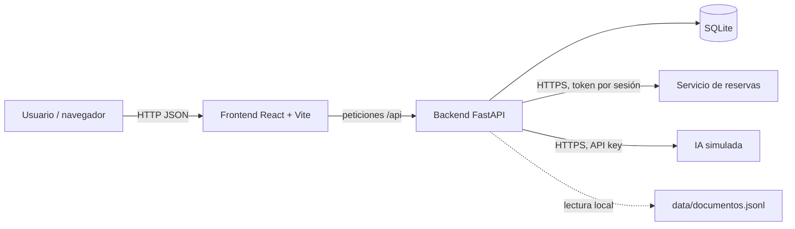
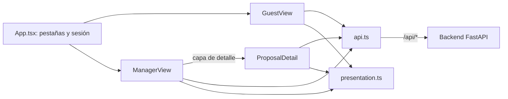
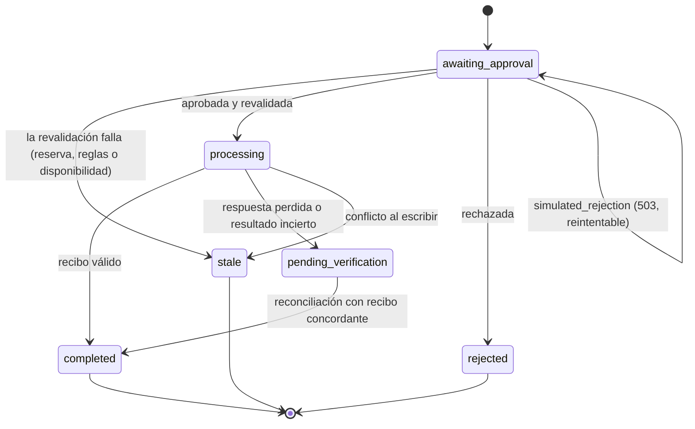
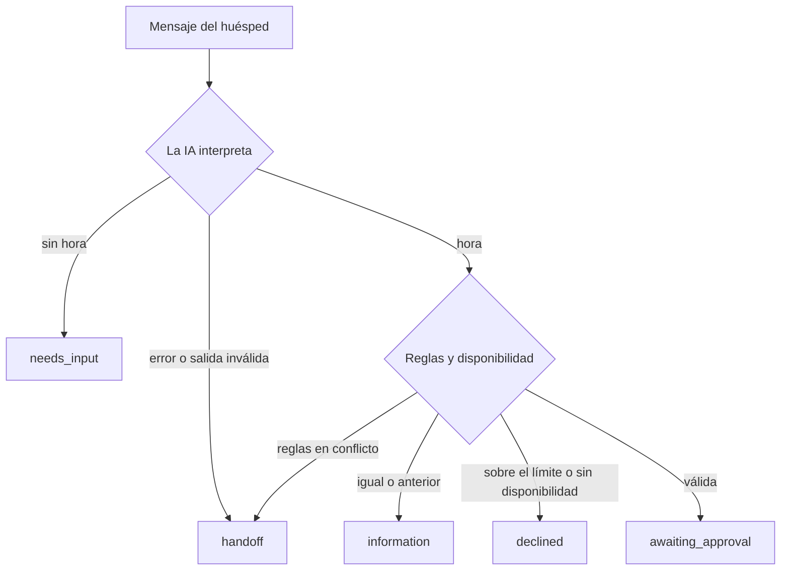

# Una salida más tarde

Aplicación web para gestionar peticiones de salida tardía en un hotel. El huésped
escribe su petición, una IA simulada la interpreta, el servidor comprueba las reglas
del hotel y la disponibilidad, y un responsable aprueba antes de que se modifique la
reserva. La web solo muestra como completado lo que el servicio de reservas ha
confirmado.

Prueba técnica de WorkFactory sobre dos servicios remotos de prueba (reservas e IA
simulada). Los hoteles, reservas y documentos son ficticios.

## Índice

1. [Arquitectura y componentes](#arquitectura-y-componentes)
2. [Estados](#estados)
3. [Conexión a los servicios](#conexión-a-los-servicios)
4. [Puesta en marcha](#puesta-en-marcha)
5. [Base de datos](#base-de-datos)
6. [Pruebas](#pruebas)
7. [Resultados de los casos](#resultados-de-los-casos)
8. [Límites y trabajo futuro](#límites-y-trabajo-futuro)
9. [Tiempo empleado](#tiempo-empleado)
10. [Decisiones](#decisiones)

## Arquitectura y componentes

El proyecto está dividido en dos partes independientes, **frontend** y **backend**,
para poder desplegar cada una por separado. El backend es un servicio HTTP autónomo,
de modo que la lógica de negocio podría reutilizarse desde otros clientes (por
ejemplo, un canal de mensajería) sin tocar la interfaz web.

Se eligió **Python con FastAPI** por ser un lenguaje idiomático y de mantenimiento
sencillo, con muy poco código para resolver cada caso, y por ser el ecosistema más
habitual para servicios de validación alrededor de modelos de lenguaje. El código
sigue el estilo de la documentación oficial de FastAPI (rutas delgadas, dependencias
e inyección de sesión) para que sea predecible y fácil de revisar.



### Piezas principales

| Pieza | Papel |
| --- | --- |
| **FastAPI** | Framework HTTP y enrutado de la API. |
| **Pydantic** | Validación de tipos: cuerpos de petición, configuración y salida de la IA. |
| **SQLModel** | ORM (tablas y consultas tipadas) sobre SQLAlchemy. |
| **SQLite** | Base de datos local, elegida por simplicidad. |
| **httpx** | Cliente HTTP hacia los servicios remotos. |
| **tenacity** | Reintentos limitados ante fallos temporales. |

### Backend (`backend/`)

| Archivo | Responsabilidad |
| --- | --- |
| `app/main.py` | Aplicación FastAPI: rutas del contrato (`/api/...`) y manejadores globales de error. |
| `app/config.py` | Configuración desde `.env` (`pydantic-settings`), `User-Agent` exigido y mapa sesión → token remoto. |
| `app/database.py` | Motor SQLite, creación de tablas, dependencia de sesión y `reset_database()`. |
| `app/models.py` | Tablas y enumerados: conversaciones, mensajes, propuestas y trazas. |
| `app/sessions.py` | Sesiones de demostración, resolución del token y dependencias de rol (`GuestDep`, `ManagerDep`), más `AppError`. |
| `app/rules.py` | Corpus documental y resolución de la política vigente del hotel. |
| `app/ai_client.py` | Cliente de la IA, validación de la interpretación y reintentos limitados. |
| `app/reservations_client.py` | Cliente del servicio de reservas y excepciones tipadas. |
| `app/service.py` | Casos de uso (mensaje, listado, aprobación y rechazo) y textos al huésped. |
| `app/language.py` | Detección de idioma de respaldo, para turnos en que la IA no responde. |
| `data/documentos.jsonl` | Corpus de documentos del hotel. |
| `tests/` | Pruebas unitarias y de integración. |

El backend mantiene un **registro de seguimiento** privado por turno (identificador de
petición de la IA, propuesta asociada, documentos usados, duración y tokens
—marcados como simulados—). Nunca se muestra al huésped.

### Rutas de la API

Todas bajo el prefijo `/api`, con la sesión de demostración resuelta por cabecera y el
rol comprobado en el servidor:

| Método | Ruta | Quién | Qué hace |
| --- | --- | --- | --- |
| `GET` | `/health` | Cualquiera | Estado del servicio (sin sesión). |
| `POST` | `/api/messages` | Huésped | Un turno de conversación: interpreta el mensaje, comprueba reglas y disponibilidad, y crea la propuesta si procede. |
| `GET` | `/api/proposals` | Responsable | Propuestas del hotel de la sesión, con `conversation_id`. |
| `POST` | `/api/proposals/{id}/approve` | Responsable | Revalida y ejecuta el cambio; responde `200`, `202` o `409`. |
| `POST` | `/api/proposals/{id}/reject` | Responsable | Rechaza la propuesta; nunca se ejecuta. |
| `POST` | `/api/proposals/{id}/reconcile` | Responsable | Comprueba una escritura incierta; no crea operaciones nuevas. |
| `GET` | `/api/conversations/{conversation_id}` | Responsable | Historial de la conversación y registro de la operación. |

### Frontend (`frontend/`)

React 19 + Vite + TypeScript + Tailwind 4, sin más dependencias que la fuente. Consume
solo las rutas `/api/*` y ofrece las tres pantallas del enunciado.

| Archivo | Responsabilidad |
| --- | --- |
| `src/api.ts` | Cliente HTTP tipado del contrato y traducción de errores a texto. |
| `src/sessions.ts` | Sesiones de demostración del kit, sesión elegida y conversación de la estancia; la elección se guarda en el navegador. |
| `src/presentation.ts` | Sello de estado, permisos por estado, formato de horas e importes y posiciones de la banda horaria. |
| `src/TimeBand.tsx` | Banda del día con la salida actual y la pedida. |
| `src/GuestView.tsx` | Pantalla del huésped: historial, redacción del mensaje y tarjeta de la solicitud. |
| `src/ManagerView.tsx` | Pantalla del responsable: propuestas del hotel, decisión, comprobación y filtros. |
| `src/ProposalDetail.tsx` | Pantalla de detalle: documento que respalda la propuesta y registro de la operación. |
| `src/App.tsx` | Cabecera, estado del backend, pestañas de rol y selector de sesión. |
| `src/index.css` | Tokens de color y tipografía, y capa base (foco visible, movimiento reducido). |
| `src/main.tsx` | Arranque, fuente autoalojada y montaje de React. |



Decisiones de interfaz que conviene conocer al leer el código:

- **Una pantalla por rol, sin enrutador.** El detalle es una capa que solo se abre desde
  la pantalla del responsable, así que la ruta de conversaciones queda
  estructuralmente fuera del alcance del huésped.
- **Un sello para el estado, con tres formas.** Relleno y girado para lo que espera una
  acción (pendiente de aprobación, en ejecución, sin comprobar), contorno recto para lo
  cerrado (completado, rechazado) y contorno discontinuo para lo que hay que rehacer
  (obsoleta, fallo). El color acompaña, no es la única señal: forma y texto van con él.
- **Nada se pinta como completado sin recibo del servicio.** Los textos de cada estado
  son los que devuelve el servidor, no frases optimistas de la interfaz.
- **Las horas se recortan del texto ISO en UTC** (`slice(11, 16)`), sin usar `Date`, para
  que una salida a las 11:00 no aparezca como 13:00 según el huso del navegador.
- **El registro de la operación** (duración, tokens simulados, `X-Request-ID` y recibo)
  solo se pide con token de responsable: el backend no lo devuelve al huésped y la
  pantalla del huésped no tiene forma de pedirlo.

## Estados

### Ciclo de la propuesta



| Estado | Significado |
| --- | --- |
| `awaiting_approval` | Propuesta creada, pendiente de aprobación. |
| `processing` | Aprobada y revalidada; el cambio está en curso. |
| `pending_verification` | No se pudo confirmar el resultado; queda pendiente de comprobar/reconciliar. |
| `completed` | Confirmada por el servicio de reservas, con recibo. |
| `rejected` | Rechazada por el responsable; nunca se ejecuta. |
| `stale` | Los datos cambiaron (reserva, reglas o disponibilidad); exige nueva propuesta. |
| `failed` | Reservado para fallos definitivos. |

### Ciclo de un turno de mensaje



## Conexión a los servicios

Todas las claves viven **solo en el servidor** (`.env`, no versionado). La plantilla
`backend/.env.example` muestra las variables sin ningún secreto. El hotel, la reserva,
el rol y el escenario los decide siempre el backend; nunca el huésped ni la IA.

Cabeceras comunes exigidas por WorkFactory: `User-Agent: WorkFactory-Technical-Test/1.0`
y `X-Test-Scenario`, que toma el valor de la variable de entorno del escenario elegido.

### Servicio de reservas

- Base: `RESERVATIONS_BASE_URL`; escenario: `RESERVATIONS_SCENARIO`, con los valores
  `normal`, `transient-503`, `response-lost` y `stale-availability`.
- Autenticación: `Authorization: Bearer <token>`, con un token **por sesión de
  demostración** resuelto en el servidor (el cliente no puede elegir token, hotel ni
  reserva).
- Rutas usadas: `GET /stays/{stay_id}`, `POST /availability/check`, `POST /changes`
  (con `expected_version` y `operation_key`) y `GET /operations/{operation_key}`.
- La ruta `POST /test/reset` se usa únicamente desde las pruebas, con
  `RESERVATIONS_TESTER_TOKEN`.

### IA simulada

- Base: `LLM_BASE_URL`; modelo: `LLM_MODEL`; escenario: `LLM_SCENARIO`.
- Autenticación: `Authorization: Bearer <LLM_API_KEY>` en `POST /chat/completions`.
- La respuesta trae, en `choices[0].message.content`, **texto que contiene otro JSON**.
  Solo se aceptan tres campos (`intent`, `requested_time`, `language`); cualquier otro
  se descarta. Un JSON roto o una hora inválida no producen cambios ni un error sin
  explicación.
- Los escenarios de fallo (`malformed-json`, `invalid-time`, `privilege-fields`,
  `transient-503`) se usan en las pruebas; el escenario `transient-503` se cubre con
  reintentos limitados (implementados con **tenacity**) que respetan `Retry-After`.

## Puesta en marcha

### Requisitos previos

Todo es local: no hay contenedores, ni servicios externos, ni base de datos que instalar.

| Herramienta | Versión | Para qué |
| --- | --- | --- |
| **uv** | reciente (probado con 0.13.1; una versión muy antigua puede volver a resolver `backend/uv.lock`) | Crea el entorno del backend, instala las dependencias fijadas en `uv.lock` y ejecuta los comandos de este README. |
| **Python** | 3.12 o superior (`requires-python` en `backend/pyproject.toml`) | Intérprete del backend. Si el del sistema es anterior, uv se encarga de descargarlo. |
| **Node.js** | 20.19 o superior, o 22.12 o superior (lo exige Vite 8) | Ejecuta y construye el frontend. Incluye `npm`. |

```bash
# uv
curl -LsSf https://astral.sh/uv/install.sh | sh

# Python 3.12, solo si el del sistema es anterior
uv python install 3.12

# Node.js 20 LTS
nvm install 20          # o el instalador de nodejs.org
```

`uv sync` instala también el grupo `dev` (`pytest`, `pytest-asyncio` y `ruff`), que es el
que hace falta para las pruebas. Si se prefiere no usar uv, el backend funciona igual con
un entorno virtual normal —`python -m venv .venv`, activarlo e instalar el proyecto más
esas tres herramientas—, pero los comandos de este documento suponen uv.

Las pruebas y el servidor deben ejecutarse **desde `backend/`**, porque `.env` y la base
de datos se resuelven de forma relativa a ese directorio.

### Backend

```bash
cd backend
uv sync                       # crea el entorno e instala dependencias
cp .env.example .env          # rellenar las claves descargadas de la prueba
uv run uvicorn app.main:app --reload
```

### Frontend

```bash
cd frontend
npm install
npm run dev
```

El frontend habla con `http://localhost:8000` por defecto; si el backend está en otro
sitio, se cambia con `VITE_API_URL` en `frontend/.env`. No hay registro ni contraseña:
la sesión de demostración se elige en la propia pantalla y solo decide qué hotel y qué
reserva se ven, porque el rol y los permisos los comprueba siempre el servidor.

### Recorrido para la demostración

1. **Pestaña Huésped**, sesión *Huésped A1*: escribir «Quiero salir a las 14:00». Aparece
   la solicitud con la reserva, la hora actual, la pedida, el importe y el documento que
   la respalda, con el sello *Pendiente de aprobación*.
2. **Pestaña Responsable**, sesión *Recepción Alba*: la propuesta aparece en la lista (se
   sigue sola cada 5 s). **Aprobar** deja *Completado* con la referencia del cambio;
   **Rechazar** no toca la reserva.
3. **Detalle** (solo responsable): documento citado y registro de la operación, con
   duración, tokens simulados, `X-Request-ID` y el recibo del servicio.
4. **Cambio sin comprobar:** poniendo `RESERVATIONS_SCENARIO=response-lost` en
   `backend/.env` y reiniciando, la aprobación responde `202` y la propuesta queda en
   *Cambio sin comprobar* hasta pulsar **Comprobar sin confirmar**.
5. **Obsoleta:** con `RESERVATIONS_SCENARIO=stale-availability`, la propuesta pasa a
   *Requiere revisión* y el aviso dice que hay que pedirlo de nuevo.
6. **IA caída:** con `LLM_SCENARIO=malformed-json` o `transient-503`, el huésped recibe
   *Revisión humana* y no se crea ninguna propuesta.

## Base de datos

SQLite, configurada con `DATABASE_URL=sqlite:///./app.db` (relativo a `backend/`). Las
tablas se crean automáticamente al arrancar la aplicación (`create_db_and_tables()`).

Se usa **SQLite por simplicidad**: no requiere servidor y basta para la prueba. Como el
acceso va siempre a través de **SQLModel** (sobre SQLAlchemy), cambiar de motor
—PostgreSQL, MySQL o una base gestionada en la nube— es sobre todo cuestión de apuntar
`DATABASE_URL` al nuevo motor e instalar su driver (`psycopg`, `pymysql`, …), además de
ajustar el `connect_args` específico de SQLite.

- **Reiniciar el entorno**: detener el servidor, borrar `backend/app.db` y volver a
  arrancar; se recrea vacío con el esquema vigente.
- **Restablecer en pruebas**: las pruebas de integración llaman a `reset_database()`
  (borra y recrea las tablas) y a `POST /test/reset` de los servicios remotos antes de
  cada caso.

## Pruebas

Dos conjuntos, separados por una marca de pytest:

- **Unitarias** (sin red): interpretación/validación de la IA, reglas, sesiones,
  permisos y detección de idioma. Se ejecutan por defecto.
- **Integración** (marca `integration`): llaman a los servicios reales, necesitan el
  `.env` con claves y reinician su estado. **No** se ejecutan por defecto.

```bash
cd backend
uv run pytest                    # solo unitarias
uv run pytest -m integration     # contra los servicios reales
```

## Resultados de los casos

Automatizados los diez grupos de `datos/casos-publicos.jsonl` (agrupando variantes) y
ejecutados contra los servicios reales.

```
uv run pytest
============ 29 passed ============

uv run pytest -m integration
============ 20 passed ============
```

| Caso | Nombre | Resultado |
| --- | --- | --- |
| P01 | Datos incompletos y contexto | Verificado |
| P02 | Camino completo e inglés | Verificado |
| P03 | Habitación sin disponibilidad | Verificado |
| P04 | Autoridad y contradicción | Verificado (incluida la variante de dos políticas v2) |
| P05 | Inyección en mensaje y documento | Verificado |
| P06 | Aislamiento y rol | Verificado |
| P07 | Duplicados y carrera | Verificado (duplicados sí; la carrera se probó en secuencia) |
| P08 | Resultado incierto y reinicio | Verificado (`response-lost` y `transient-503`, con reconciliación) |
| P09 | Propuesta obsoleta | Verificado (escenario `stale-availability` y variante de política) |
| P10 | Modelo inválido y rechazo | Verificado (`invalid-time`, `malformed-json`, `privilege-fields`, `transient-503`) |

### Fallos encontrados y corregidos

1. **`ReservationNotFoundError` no heredaba de `ReservationServiceError`.** Una
   reserva ajena o inexistente escapaba del mapeo de errores en lugar de traducirse al
   `403`/`404` del contrato. Se corrigió la jerarquía de excepciones.
2. **El mensaje de derivación salía siempre en español.** Con la IA caída, un huésped
   que escribía en inglés recibía la respuesta en español. Se corrigió recordando el
   idioma de la conversación y, si no lo había, estimándolo del texto.
3. **El historial del huésped solo mostraba las respuestas del hotel.**
   `get_conversation` proyectaba los mensajes sin el texto del huésped, así que su lado
   de la conversación aparecía vacío. Se corrigió incluyendo el texto en la proyección y
   se comprobó sobre las claves que devuelve cada mensaje.
4. **La lista de propuestas no decía a qué conversación pertenecía cada una.** El detalle
   necesita ese dato para pedir el historial. Se añadió `conversation_id` a la respuesta
   resolviendo el mapa de conversaciones con **una sola consulta `IN`**, en lugar de una
   consulta por propuesta.

## Límites y trabajo futuro

- **Idiomas.** Los idiomas (`es`, `en`) están fijados en varias capas: la validación y
  el prompt de `ai_client`, la normalización en `service` y el catálogo de textos
  `_msg_*`. Para ampliarlos sin tocar código, se extraerían a ficheros de idioma
  externos con un registro cargado al arranque, plantillas por clave y un idioma por
  defecto configurable. Además, la detección del idioma la realiza el modelo remoto,
  que hoy solo reconoce español e inglés: añadir un idioma exige también soporte en el
  proveedor (o un detector propio).
- **Pruebas del frontend.** No hay pruebas automatizadas de los componentes. La
  verificación hecha es tipado y compilación (`tsc -b`), construcción con Vite, un render
  de humo del árbol completo en Node y la revisión manual del recorrido. Lo siguiente
  sería cubrir con Vitest la lógica de `presentation.ts`, que es donde se concentran las
  reglas de sellos y permisos.
- **Del frontend, lo demás.** No hay enrutador ni estado global: con tres pantallas no
  hacía falta, pero con más vistas habría que añadirlos. Tampoco se ha auditado con
  lector de pantalla; hay foco visible, etiquetas y cierre con `Escape`, pero la
  accesibilidad no está certificada.
- **El seguimiento de cambios del responsable es un sondeo cada 5 s**, suficiente para
  una demostración en la que las dos pantallas conviven. En producción sería un canal de
  eventos o un refresco bajo demanda.
- **Sin autenticación real** (sesiones de demostración) y **sin pagos**, por diseño de
  la prueba.

## Tiempo empleado

| Día | Tiempo | Trabajo |
| --- | --- | --- |
| 1 | 2 h 30 min | Estudio de requisitos y diseño de la arquitectura; esqueleto inicial, sesiones, reglas y cliente de reservas con sus pruebas. |
| 2 | 1 h 30 min | Unificación de errores y del formato de salida, reintentos con `tenacity` y corrección de los primeros fallos. |
| 3 | 1 h 30 min | Capa de servicio y rutas de mensaje, listado, aprobación y rechazo. |
| 4 | 2 h 30 min | Reconciliación y ruta de conversaciones con sus pruebas; frontend completo (tres pantallas, sistema de presentación y verificación); documentación. |

Total dedicado: **8 h** en cuatro de los cinco días naturales disponibles. El límite del
enunciado es de 8 h. Los tiempos son aproximados y están redondeados a media hora.

## Decisiones

Resumen de las tres decisiones principales; el detalle está en
[`DECISIONES.md`](DECISIONES.md).

1. **Backend desacoplado con Python y FastAPI.**
2. **Rutas delgadas y una capa de servicio aparte** (`main.py` / `service.py`).
3. **Cambios fiables**: identificador de operación idempotente y revalidación de
   reserva, reglas y disponibilidad antes de escribir.
